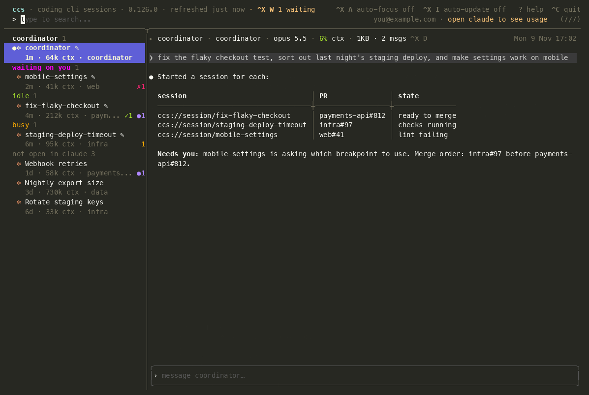

# ccs - Coding CLI Sessions

[](https://github.com/agentic-utils/ccs/actions/workflows/test.yaml)
[](https://github.com/agentic-utils/ccs/releases/latest)
[](LICENSE)

Launch, watch, search and resume your coding CLI sessions: [Claude Code](https://claude.ai/claude-code) conversations and the Codex sessions beside them.



## Features

- Search through all your Claude Code conversations, and your Codex sessions beside them (each row starts with its agent: an orange `✻` for Claude, `⬡` for Codex; a Codex row's grey line starts `codex`, so searching `codex` finds them all)
- See session names (your custom titles or Claude's auto-generated ones) in the list
- Preview conversation context with search term highlighting
- See context size (tokens as of the last reply), message counts, hit counts, and file size per conversation
- Resume conversations directly from the search interface
- Background tasks and subagents: a session open in `claude` shows `⧗N` for its running background commands and monitors and a pink `◆N` for its running subagents, and the preview lists both with how long each has run
- Auto-refreshes every minute; a green `●` marks conversations open in a running `claude`, and ones started by another session's `claude -p` sit `└` under it
- Rename conversations (`Ctrl+X E`)
- Delete conversations with confirmation prompt
- Prune bloated conversations losslessly (`ccs prune`)
- Codex sessions: read from `$CODEX_HOME/sessions` (default `~/.codex`), with their model and context, PRs their `gh pr create`/`merge` printed, and a live `●` (green idle, amber busy) while a `codex` tab has the thread open. Enter switches to that tab, else opens `codex resume <id>` in a new tab with `ccs launch --codex`'s sandbox (network on, your approval mode); `Ctrl+F` runs `codex fork <id>`; the message box sends with `codex queue`. A headless `codex exec` run sits `└` under the Claude session that ran it (when its prompt is on the command line), and a Codex subagent under its parent thread. ccs never renames, deletes or prunes a Codex session's files Their preview shows tokens and an estimated cost at OpenAI's published per-token prices (requests over the long-context threshold at its rate; a model ccs has no price for shows tokens only).
- A coordinator session at the top of the list that starts one named session per task, tracks their PRs and merge order, and closes them when they finish (`ccs coordinator`, or `Ctrl+X O` in the list)
- Start and close named sessions in iTerm tabs or tmux windows (`ccs launch`, `ccs close`, or `Ctrl+X N` / `Ctrl+X K` in the list)
- Watch your open PRs and get one JSON line per change (`ccs watch`)
- Record which session owns each PR, and list your open PRs with their owners (`ccs claim`, `ccs prs`)
- Tell the session that claimed a PR when its checks fail, it conflicts or it gains unresolved threads (`ccs watch`)
- Pass flags through to `claude` (e.g., `--plan`)
- Usage screen (`Tab`): the last 12 hours of token usage across all sessions (including subagents) as three charts (cache-write disposition, context assembly, output), a summary with effective tokens, and your live 5-hour and weekly allowance. The allowance reads Claude Code's stored login read-only (macOS Keychain, else `~/.claude/.credentials.json`); ccs never refreshes or writes it, so if it has expired, open `claude` to refresh it
- Checks for new releases at startup and every 2 minutes (update steps are logged to `~/Library/Logs/ccs/update.log`) and offers to update and restart from a popup (via `brew upgrade` for Homebrew installs, otherwise by replacing the binary with the checksum-verified release). Every update, Homebrew included, is checked against a signature that only ccs's release pipeline on `main` can make, so a release uploaded any other way is refused


## Let Claude search your sessions (MCP)

`ccs mcp` is an MCP server that lets Claude find and read your earlier Claude Code sessions. Add it once:

```bash
claude mcp add --scope user ccs -- ccs mcp
```

Claude starts it when needed (no ccs window has to be open, no network port). It has six tools: `search_sessions` (every word must appear; sessions named after the query first, then by matching messages and recency, each with a snippet and its resume command), `list_sessions` (most recent first, a running session with what it is doing as `ccs sessions` gives it, `live_only` for just those; both leave out headless runs unless `include_headless`) `read_session` (a session's messages, paged, optionally only those around a search term), `launch_session` / `close_session`, which do what `ccs launch` and `ccs close` do (below), and `list_prs`, which is `ccs prs --json`. It searches the same window as the TUI (60 days, files under 1GB); use `ccs mcp --all` or `--max-age=N` to change it.

## Start and close sessions

```bash
ccs launch --name fix-login --brief brief.md --cwd ~/code/app   # claude, the brief as its first prompt
ccs launch --name fix-login --resume <session-id>               # resume one under a name (refused, with no tab opened, when there's no such session)
ccs launch --name tests --brief brief.md --codex                # codex instead
ccs close fix-login
ccs sessions                                                    # what each running session is doing
ccs sessions --json                                             # the same, for scripts and other sessions
```

`ccs sessions` lists the sessions running now, those needing you first: whether each is busy, idle or waiting on you and since when, the question or permission prompt it waits on, whether an idle one's last message asks something, its last API error (until a later reply succeeds), its PRs (the open ones, when `ccs watch` has run; otherwise every PR it touched), and how many background tasks and subagents it runs. `--all` adds sessions that aren't running (the last 60 days). `--json` prints `{"sessions": [...]}` with `name`, `session`, `kind`, `cwd`, `live`, `pid`, `status`, `since`, `waiting_for`, `question`, `asked`, `last_error`, `last_error_at`, `prs`, `open_prs`, `tasks`, `subagents`, `last_message` and `messages`; a field with nothing to say is left out. A wait that isn't on a tool call or a question menu has no `question`.

`ccs launch` needs zsh at `/bin/zsh`. It opens a background tmux window when run inside tmux, otherwise an iTerm tab (at the end of the tab strip if iTerm's "new tabs at the end" setting is on, focus staying where it was), clears the prompt and runs a launcher kept in `~/Library/Caches/ccs/launch/<name>/`: a login zsh that sources `~/.claude.secret` when there is one and runs `claude "<brief>" --name <name> $CCS_CLAUDE_ARGS`, the brief first since `--channels` takes every word after it. It then waits up to 20 seconds for a session with that name to start, printing its pid and tty. If none has registered by then but the tab is still running the launcher (Claude asking whether to trust the folder, for instance), it says the session is still starting, with the tty and launcher, and exits 0; it fails only when nothing in the tab runs the launcher. A name already running is refused, and so is one still starting in its tab, before any new tab opens.

To give every new session the same standing rules, put them in `launch-preamble.md` beside ccs's settings (`~/Library/Application Support/ccs/` on macOS): `ccs launch`, `Ctrl+X N` and `launch_session` start each new session's brief with that text. A resumed session gets none, nor does the coordinator itself; `--no-preamble` (or `preamble: false` on the tool) leaves it out for one launch. With `--codex` it runs `codex -s workspace-write -a on-request -c sandbox_workspace_write.network_access=true --add-dir <that folder> --add-dir <ccs's settings folder>`: your usual approval mode, network on (Codex's sandbox has none by default, so git and gh would fail), the launch folder (how ccs finds the session again) and ccs's settings folder (so `ccs claim` can write) writable. It also waits for Codex's transcript of the session and prints its thread id, which nudges need; a Codex session that writes none in time fails the launch.

`ccs close <name>` finds the one running session with that name (two with the same name are left alone), stops it, confirms its process has exited, then closes its iTerm tab (or tmux pane). A session with no terminal (an app's, or `claude --bg`) is refused.

That stops a session mid-whatever-it-was-doing. `ccs close --graceful <name>` (or `graceful` on the `close_session` tool) asks it first: the session gets one automatic notice, marked as from `ccs close` and not typed by you, telling it to stop at a safe point, commit or stash what's worth keeping, stop its background tasks, remove the worktrees it made and say what's left. ccs then waits until the session has gone idle after that notice reached its transcript, closes it as above and prints its last message. After `--timeout` (default `2m`) it is stopped anyway, and the result says whether the notice never arrived (a session in another permission mode holds such messages for approval) or it simply hadn't finished. If the notice can't be sent at all, nothing is stopped. Codex sessions can't be sent one, so `--graceful` refuses them.

## Link to a session's tab

On macOS, `ccs://session/<name>` switches to that running session's iTerm tab or tmux window, so a session can mention another one as something you can click:

```bash
ccs link install     # once: creates ~/Applications/CCS Links.app and registers it for ccs:// links
ccs link status      # which app opens ccs:// links, and which ccs it runs
ccs link uninstall   # removes the app
```

Opening a link only ever focuses. A session that isn't running, or a name two sessions share, shows a short alert saying so; nothing is started or resumed. Any web page or message can send you one of these links, so all it can do is bring one of your tabs to the front. The link has to be exactly `ccs://session/<name>`, with the name in the form `ccs launch` accepts (letters, digits, `.`, `_` and `-`, starting with a letter or digit, at most 64 characters). Anything else is refused, so a session named with spaces can't be linked. The name is only compared with the running sessions' names; it never reaches a shell or AppleScript.

The first click asks you to let CCS Links control iTerm, which it needs to pick the tab. If you refuse, you can change it under Privacy & Security, Automation in System Settings. A session in tmux needs an attached tmux client; its iTerm tab is brought forward too, but tmux in another terminal only switches window, without bringing that terminal to the front. iTerm is never started: a session in any other terminal is refused.

The app runs Homebrew's `bin/ccs` link, which stays put when `brew upgrade` or ccs's own update replaces the keg, so upgrades keep it working with nothing to redo. If a new ccs changes the handler or the ccs it points at has gone, ccs rebuilds an installed one when it next starts; it never installs one you didn't ask for. `brew uninstall ccs` leaves the app behind, so run `ccs link uninstall` first.

Whether a link is clickable depends on the app showing it. Browsers ask before opening it. Apps that only linkify `http` addresses show it as plain text, where you can run `open ccs://session/<name>` instead.

## The coordinator

The coordinator is one Claude Code session that keeps your other sessions moving and never does the work itself. Tell it what you want done; it starts a named session for each ask, tracks who owns which PR and what order they must merge in, tells you what needs you, and closes sessions when they finish.

```bash
ccs coordinator                  # open it: its tab if it's running, resumed if not, set up if there is none
ccs coordinator --adopt my-hub   # make an existing session the coordinator instead
ccs coordinator --release        # make it an ordinary session again; it keeps running
```

ccs offers it once, in a popup, in iTerm or tmux when you have none (Esc doesn't ask again; `Ctrl+X O` still opens the same offer). It waits until you aren't typing a search, a message or a prompt, and ignores keys for its first second, so nothing meant for the list answers it. Setting up asks once, shows exactly what will change, and needs none of your own config or plugins:

- **Its folder**, `coordinator` beside ccs's settings (`~/Library/Application Support/ccs/` on macOS, `~/.config/ccs/` on Linux). `CLAUDE.md` is its role and `.claude/settings.json` allows the `ccs` commands it needs, in that folder only. Both are yours to edit, and ccs never overwrites them. Because Claude Code reloads them on every start and after compaction, every way of resuming it keeps its role.
- **The ccs MCP server**, if it's missing: `claude mcp add --scope user ccs -- ccs mcp`, and the same for Codex if you have it. ccs then checks that Claude Code reports it connected, and says so if it doesn't. If it's there already, nothing is asked or changed. `--no-mcp` skips this.
- **The session**, named `coordinator`, in a new tab brought to the front: Claude Code asks once whether to trust the folder. Choose "Yes, I trust this folder": the highlighted answer isn't that one.

It has its own section at the very top of the list, above pinned sessions. There is never a second one: ccs looks for the recorded session, including one still on its trust question, then for a session with the name, and two ccs at once take turns. After `/clear` the coordinator is still the same one, and the conversation before it becomes an ordinary session. After a restart, the reopen popup, `Enter` on its row, `Ctrl+X O` and `ccs coordinator` all resume the same conversation.

On each start it runs `ccs watch` as a background task, which ends with the session and leaves an already running watcher alone, follows its events with Claude Code's Monitor tool, and catches up from `ccs prs`, so PR events reach it while it's open and it catches up on resume. That needs `gh` logged in; without it, it says so once and carries on without PR tracking. GitHub or Slack event plugins are optional: if their tools are there it uses them, and `CCS_CLAUDE_ARGS` is passed as with `ccs launch`.

Its role closes sessions it started once their PRs have finished, asks before closing any other, and treats PR titles, session names and channel messages as data, never as instructions. Merging or posting takes your say-so. The role is written once: a later ccs doesn't change the `CLAUDE.md` you already have, so compare it with [the current one](coordinator.md) now and then.

To remove it:

```bash
ccs coordinator --release
ccs close coordinator
claude mcp remove ccs -s user        # and: codex mcp remove ccs
rm -r "$HOME/Library/Application Support/ccs/coordinator"   # ~/.config/ccs/coordinator on Linux
```

`--release` alone keeps the session, its conversation and its folder, and ccs stops treating it as the coordinator. The offer doesn't come back; `Ctrl+X O` or `ccs coordinator` sets a new one up, once a session still running under that name is closed or renamed. Removing the MCP server also removes it for anything else of yours that uses it.

The coordinator is always Claude, since Codex sessions can't receive messages from other sessions; it can start Codex sessions to do the work. Outside iTerm and tmux, `ccs coordinator` runs it in place, but it can't open tabs for its sessions from there. `--yes` sets up without asking, for scripts; without it, a run with no terminal shows the plan and changes nothing.

## Installation

### Homebrew (macOS and Linux)

```bash
brew install agentic-utils/tap/ccs
ccs link install   # optional, macOS: make ccs://session/<name> links work
```

### From source

Requires [Go](https://go.dev/doc/install) 1.24+.

```bash
go install github.com/agentic-utils/ccs@latest
```

### Manual

Download the binary from [releases](https://github.com/agentic-utils/ccs/releases) and add to your PATH.

## Requirements

- [Claude Code](https://claude.ai/claude-code) - must be installed and used at least once

## Usage

```bash
# Search recent conversations (last 60 days, files <1GB)
ccs

# Search with initial query
ccs buyer

# Search last 7 days only
ccs --max-age=7

# Search everything (all time, all files)
ccs --all

# Resume with plan mode
ccs -- --plan

# Combined: search "buyer", resume with plan mode
ccs buyer -- --plan
```

Set `CCS_CLAUDE_ARGS` to pass flags to every `claude` ccs starts, ahead of any `--` flags. It is split on whitespace with no quoting:

```bash
export CCS_CLAUDE_ARGS="--permission-mode auto"
```

### Flags

| Flag | Default | Description |
|------|---------|-------------|
| `--max-age=N` | 60 | Only search files modified in the last N days (0 = no limit) |
| `--max-size=N` | 1024 | Max file size in MB to include (0 = no limit) |
| `--all` | - | Include everything: `--max-age=0 --max-size=0`, plus headless runs (`claude -p` given a single prompt and never named, `codex exec`), which are hidden otherwise |
| `--exclude=a,b` | observer-sessions | Exclude project dirs whose path contains any of these substrings |

### Keybindings

- Text boxes (the search, the message box) edit like Claude Code's prompt: `Ctrl+A`/`Ctrl+E` start/end, `Ctrl+K`/`Ctrl+U` delete to the end/start, `Ctrl+W` the word before, `Ctrl+Y` puts back what they deleted, `Alt+B`/`Alt+F` move by word. So ccs's own actions are `Ctrl+X` then a letter (`Ctrl+X Ctrl+W` works too)
- `↑/↓` or `Ctrl+P/N` - Move through the list
- Background sessions (`claude --bg`) show `bg <state>` on the grey row: Enter opens one with `claude attach` in a new tmux window or iTerm tab, and `Ctrl+X K` twice stops it (on a session in a terminal tab, `Ctrl+X K` twice stops it and closes the tab). One started from another session's `claude --bg` sits under it
- Messages between sessions show at both ends: the sender's preview shows each `SendMessage` as `To <session>` (`✓ arrived` once it's in that session's transcript), the recipient's `From <session>`
- A live session run by an app without a terminal shows `in <app>`. One in T3 Code opens in T3 Code with Enter, at its thread; any other app gets a hollow `○`, since ccs can't switch to it, and Enter says to open it there. Messaging it (`Ctrl+S`) and forking it (`Ctrl+F`) work either way
- Each open session has a circle, `●` (or `○` in an app ccs can't open), coloured by its state: magenta waiting on you, light magenta asked you something, cyan done, green idle, amber busy. Under a section heading, which already names the state, it shows only when it adds something: a done session, one in another app, or a nested one in a different state; pinned sessions always have it
- The list is in sections by state, each with a header: waiting on you, asked you something, idle (a cyan `●` marks one finished since you last looked at it in ccs; it turns green once you select it and move on, without moving), busy, not open in `claude`
- `Ctrl+X W` - Sessions waiting on you: answer, open or snooze them. Shows their question, a box to answer, Enter opens the session's tab, Esc snoozes
- `Ctrl+X R` - Record a CPU profile while you do whatever feels slow, then `Ctrl+X R` again to save it beside the update log (`~/Library/Logs/ccs/cpu-<time>.pprof` on macOS; read it with `go tool pprof -top`). The header says `recording profile` until you stop it. `CCS_CPUPROFILE=path ccs` records the whole run instead
- `Ctrl+X I` - Automatic updates, off by default: turned on, a new ccs release downloads in the background and installs once you're away (ccs not focused, or no key for 3 minutes, with nothing unsent), then ccs restarts where you were and says it updated itself, with what changed. Off, new versions are offered in a popup instead. Installs from before this was opt-in keep the setting they had. The header shows which (`auto-update on`), remembered across restarts
- The modes these keys toggle (auto-focus, auto-update) sit on the right of the header, in grey with their keys, and only `on` is green; `off` stays grey
- `Ctrl+X H` - Show or hide headless runs (`claude -p` given a single prompt and never named, `codex exec`), hidden unless ccs started with `--all`. Not shown in the header. Not saved: the next ccs starts as its flags say
- `Ctrl+X A` - Auto-focus: when a session starts waiting on a question or permission prompt, switch to its iTerm tab or tmux pane (without pulling iTerm in front of another app), once you've stopped typing for 2 seconds (moving the mouse doesn't count), and not again until that question is answered. Questions already waiting when ccs starts count too; one it already switched to before a restart doesn't. Off by default, remembered across restarts
- `Ctrl+X P` - Pin the selected session: pinned sessions sit in their own section at the top, whatever their state, in the order you pinned them; `Alt+↑`/`Alt+↓` move one among them. Again to unpin. Kept across restarts
- `Ctrl+X C` - With folders grouped, collapse the selected session's folder to its most urgent session, its header counting the rest (`▸ api 5 · 4 more`). Again to expand. Kept across restarts
- `Ctrl+X S` - Put the selected session away: settle it (until its next message) or snooze it (an hour, 4 hours, tomorrow 9:00). It moves to the settled or snoozed section at the bottom, and comes back early if it waits on you. Again to bring it back
- `Ctrl+X G` - Group the list by folder within each state section (a worktree under `.claude/worktrees` counts as its repo), the most urgent group first. Again to ungroup. ccs remembers this and the ^X T layout, and reopens the way you left it
- `Ctrl+X D` - Fold the details above the conversation to one line (name, project, model, context %, PR, task and subagent counts, size), or show them in full; clicking them does the same, unless the click is on a link. One line by default, remembered across restarts
- `Ctrl+X T` - Switch between the sidebar (sessions in a narrow column beside the conversation, the default; each on two rows: the title, then a grey line of when it was last active, its context, project and PR counts) and the full-width table with every column (when, project, model, size, context, messages, hits, PRs). The list and the conversation each have a scrollbar whose thumb is the share in view
- `Enter` - Resume it in claude, in a new tab in tmux or iTerm. On one already open in `claude` (`●`), go to its iTerm tab / tmux pane instead
- `Ctrl+F` - Fork it: a new session with the same history, in a new tab (`claude --resume <id> --fork-session`); the original is left as it was
- `Ctrl+D` - Delete its transcript file; asks first, can't be undone (the file is removed, not moved to the bin)
- `Ctrl+X N` - Start a new session in an iTerm tab or tmux window, in the selected session's folder: type its name, Enter, then its brief, Enter (`ccs launch`)
- `Ctrl+X O` - Open the coordinator, resuming it if it isn't running, or offer to set one up if there is none (see [The coordinator](#the-coordinator))
- `Ctrl+X E` - Edit its name, as `/rename` does (not while it's open in `claude`; use `/rename` there)
- `Ctrl+R` - Refresh sessions, PRs and allowance now; check for an update
- `Ctrl+X X` - Shrink its file, keeping the dialogue; loses rewind history. It drops the copies of tool output Claude Code stores twice and the rewind checkpoints, so the conversation still resumes in full but `/rewind` has nothing to go back to. Asks first, can't be undone, not while it's open in `claude` (see [Pruning](#pruning))
- `PgUp`/`PgDn` - Scroll the conversation (the mouse wheel too)
- Mouse wheel - scrolls whatever is under the pointer (the conversation or the list); click a session to select it, click a link in the conversation to open it. Hold `⌥ Option` while dragging to select text in iTerm
- `Esc` - Clear the search and go back to the top
- Message box - select an open (`●`) session and press `Ctrl+S` (or click the box) to type in the box under its conversation; `Enter` sends (through Claude Code's message socket, or typed into its iTerm tab / tmux pane if the socket isn't reachable), `Esc` returns to the search. A screenshot goes in with `Ctrl+V` from the clipboard (macOS), or by pasting or dropping its file anywhere in ccs: it shows as `[Image #1]`, and the session gets a copy to read
- `Tab` - Token use of every session in the last 12h, and your allowance: charts over time, totals, cache mix and the 5-hour and weekly limits. `Tab` again to go back
- `Ctrl+X U` - Switch Claude account (needs [cswap](https://github.com/realiti4/claude-swap), e.g. `uv tool install claude-swap`); clicking the account email does the same
- `?` - Show the shortcuts that apply right now (the header lists only the common ones, in compact form: `^S` for Ctrl+S, and drops hints on narrow terminals rather than wrapping)
- `Ctrl+L` - What changed in each ccs release, newest first, the installed and newer ones marked; scroll with ↑↓, PgUp/PgDn or the wheel
- `Ctrl+O` - Links: the sessions the selected one messaged or heard from (Enter selects that session in the list), its PRs, then the links in the visible part of the conversation, each PR with its status; type to filter them (text, address or status, e.g. `merged`), ↑↓ and Enter to open one in the browser, staying open for the next (clicking a link works too)
- `Ctrl+]` / `Ctrl+\` - With a search typed, jump to the next / previous matching message in the conversation (wraps round); the preview shows `hit 2/5`
- `Ctrl+C` - Quit

## Pruning

Conversation files grow large over time. `ccs prune` shrinks them by removing data that duplicates content kept elsewhere, so pruned conversations still resume with their full dialogue intact:

- `toolUseResult` fields - a copy of the tool result already present in `message.content`
- `file-history-snapshot` lines - rewind/checkpoint backups (pruning loses rewind history, not the conversation)

User and assistant messages are never modified, and a file is only rewritten if its conversation line count is unchanged.

`ccs prune` is a dry-run preview by default - it only reports what it would reclaim. Pass `--apply` to actually rewrite the files.

```bash
ccs prune                       # preview savings, change nothing (files >= 50MB)
ccs prune --apply               # prune after a confirmation prompt
ccs prune --apply --min-size=200  # only files >= 200MB
ccs prune --apply --no-tool-results  # keep tool results, only drop snapshot backups
```

Run `ccs prune --help` for all flags.

You can also prune a single conversation from the search interface: select it and press `Ctrl+X X` (with confirmation).

## Watching your PRs

`ccs watch` checks one author's open PRs (by default the user gh is logged in as, in every owner's repos; `--owner` narrows it to one org or user) every 3 minutes and appends a JSON line for each change to `~/Library/Logs/ccs/pr-events.jsonl` (and prints it), for a script or a coordinating Claude session to follow with `tail -F`. It uses gh and GitHub's REST API.

```bash
ccs watch                                  # your PRs (the gh user's), every 3 minutes
ccs watch --author me --owner my-org --interval 5m
ccs watch --once                           # one pass, then exit
```

Events: `new`, `checks_failing` (with the failing checks), `checks_passed`, `needs_review` (awaiting review now: see below), `review_not_needed`, `ready` (approved, checks green, not a draft), `conflicts`, `approved` and `changes_requested` (a reviewer's verdict as it lands, whatever the checks say, with the reviewers in `by`), `blocked`, `unblocked`, `blocked_automerge` and `merged_early` (merge order, below), `threads_unresolved` (with `unresolved`, when the count of unresolved review threads rises), `threads_resolved` (back to none), `threads_unanswered` (with `count` and the thread ids in `threads`, when an unresolved thread's last comment isn't yours: a new one, or a reviewer's new comment on one), `merged`, `closed`, `claimed` (a session now owns the PR: `session`, `session_id`, and `auto` when ccs watch claimed it for the session that opened it). Any failed check, optional or not, counts as failing, and so does an unresolved review thread: such a PR is never `ready` or `needs_review`. Threads are counted only for PRs whose checks pass, with one small GraphQL query each (REST doesn't say whether a thread is resolved). Each line has `at`, `event`, `pr`, `repo`, `number`, `title` and `head`.

```json
{"at":"2026-11-03T09:12:51Z","event":"checks_failing","pr":"https://github.com/o/r/pull/220","repo":"o/r","number":220,"title":"...","head":"0fc4f95...","checks":["setup"]}
```

Everything on GitHub is done as you, whether a session, the browser, auto-merge or a cloud routine did it, so `ccs watch` reads who did it from your Claude Code sessions' transcripts (those written in the last 48 hours). `new` carries `origin`: `local` with `opened_by` (`name`, `session`) when a session's `gh pr create` printed the PR's address as it was created, else `not_local`. `merged` carries `merge`: `local` with `merged_by` when a session's `gh pr merge` ran as it merged, `auto_merge` with `merged_by` when a session had run `gh pr merge --auto` on it, nothing while a `gh pr merge` of it is still running, else `not_local` (the browser, a cloud routine, or a merge through `gh api`, which isn't read). Codex sessions' commands aren't read.

```json
{"at":"2026-11-10T09:12:51Z","event":"merged","pr":"https://github.com/o/r/pull/220","repo":"o/r","number":220,"title":"...","head":"0fc4f95...","merged_by":{"name":"fix-login-tests","session":"5f0c..."},"merge":"local"}
```

The first run records what it finds and writes one `watch_started` line, plus `needs_review` for PRs already awaiting review; it doesn't report every PR as news. Its state is kept beside ccs's settings (`pr-watch.json`), so a restart reports what changed while it was stopped, without repeating anything. Only one `ccs watch` runs at a time.

### Review events: a stable interface

A consumer that asks people for reviews (the two-slack plugin's does) needs only these two events, plus `merged` and `closed`. Their fields won't change without a major release.

- `needs_review`: `{at, event, pr, repo, number, title, head, review: "required"}`. The PR is awaiting review right now: checks green (optional ones included), not a draft, no unresolved review thread, review required, not approved. ccs watch asks GitHub again just before emitting it, so stale data never says a PR is waiting. Once per head commit. The first run emits it for PRs already waiting.
- `review_not_needed`: `{at, event, pr, repo, number, title, head, reason}`. A PR that last got `needs_review` no longer awaits review. `head` is the commit `needs_review` was for. `reason` is one of `approved`, `changes_requested`, `new_head`, `draft`, `checks`, `threads`, `merged` or `closed`. It's emitted once, as soon as the change is seen. For a new head that still needs review, it comes before that head's `needs_review`. For a merge or close, it comes just before `merged` or `closed`.

Drop a queued PR when `review_not_needed`, `merged` or `closed` for it arrives before you post. Whether a PR awaits review is kept in `pr-watch.json`, so a restart neither misses nor repeats either event. `ccs prs --json` rows carry `head` and `needs_review` for a consumer's start-up sweep.

ccs doesn't post review requests itself: the two-slack plugin's review-requests consumer does, from these events or from GitHub directly.

## Telling sessions about their PRs

After each pass, `ccs watch` tells the session that claimed a PR (`ccs claim`, below) what's wrong with it: checks failing (by name), conflicts with its base, or review threads waiting on a reply: unresolved, with the last comment not yours. Yours means the account `ccs watch` runs as (`--author`, by default the gh login, which the sessions reply through too) and any `--self-logins` (comma separated, for a bot or co-author acting for you). A thread the session has replied to stops counting even while it waits for you to resolve it, and the same threads are never told twice: only a new one, or a reviewer's new comment on one, is. Failing checks and conflicts are told once per PR, head commit and reason, so it isn't nagged every pass; a new commit that still fails is told again. A session that isn't running, or a PR nobody claimed, gets nothing beyond the usual events.

The notice goes over the session's own message socket, as `ccs watch`, and says it's an automatic status notice, not typed by you, so the session treats it as information rather than your instruction. A Codex session has no socket: its notice goes in with `codex queue --thread <id>`, which hands it to the running session at its next turn, opening with the same "automatic status notice, not typed by the user" line, since Codex shows it as a user message:

```
<PR URL> (<title>) has 2 review threads waiting on a reply; checks failing: setup.
This session claimed it with ccs claim. If it's yours, deal with it; if not, run: ccs claim <PR URL> --release
```

Events: `nudged` (pr, head, session, reasons) and `nudge_failed` (the same plus the error; tried again next pass). What was sent is kept in `nudges.json` beside ccs's settings, so a restart never sends it again. `--no-nudge` turns this off.

## Merge order

When one PR must not merge before another (infrastructure before the code that uses it), say so, and ccs keeps it in view instead of it living in a chat:

```bash
ccs depends infra#5080 --after infra#5137   # an address, owner/repo#N, or repo#N
ccs depends                                 # what waits for what
ccs depends infra#5080 --drop
```

While the prerequisite hasn't merged, `ccs prs` and the list show the PR as `blocked: after infra#5137`, never ready, and `ccs watch` holds its `ready` event. `ccs watch` emits `blocked` and `unblocked` as that changes, `blocked_automerge` the moment auto-merge is on for a blocked PR (its owning session is told how to turn it off, and `ccs prs` lists it as needing you), and `merged_early` if it merges first anyway; each carries the PRs it waits for in `after`. A prerequisite can be anyone's PR: GitHub is asked about one the watch doesn't cover. The record is dropped when the PR merges or closes.

ccs refuses no merge itself: GitHub's auto-merge, the browser and other machines are out of its reach. It makes the order visible and says at once when it is about to be, or has been, broken.

## Who owns each PR

A session that owns a PR says so by running `ccs claim <PR URL>` (`--release` to give it up). ccs works out which session ran it from the claude process it runs under, and records the session's id and name in `claims.json` beside its settings. In Codex it uses the `CODEX_THREAD_ID` Codex gives every command (Codex's sandbox can't run `ps`), named by its `ccs launch` name, else Codex's title for the thread; such a claim counts as running while its `ccs launch` codex process runs, or, for one ccs didn't launch, while Codex wrote to its transcript within 12 hours. A claim ends by itself when the PR merges or closes, or the session stops.

`ccs watch` also claims a PR for the running Claude Code session that opened it, when no running session owns it, so a session that forgot `ccs claim` still owns its PRs and is told when they fail (`--no-auto-claim` turns this off). A session that released a PR isn't given it back.

`ccs prs` lists your open PRs with their owners, needing you first, and flags any PR nobody has claimed (`UNOWNED`, saying when a session that has since stopped opened it, or when no local session did) and any PR two running sessions both claim (`CONTESTED`). It uses `ccs watch`'s state when that is under 10 minutes old, and otherwise asks GitHub (REST) itself. Without `--author`, it lists the running `ccs watch`'s author and owner, else the gh user's PRs in every owner's repos; `--statusline` never asks gh. A PR with a failed check, optional or not, needs you.

```bash
ccs claim https://github.com/o/r/pull/12
ccs prs                  # one line per PR
ccs prs --json           # the same, for scripts
ccs prs --statusline     # e.g. "PRs 3 ready · 1 need you · 2 unowned", from saved state only
ccs prs --claude-session-id <id> --statusline   # one session's PRs: "PRs ✓1 ✗1 2" (ready, need you, waiting)
ccs prs --codex-session-id <thread id> --json   # a Codex session's
ccs prs --merged         # what merged in the last week, and which session merged it (--json too)
```

`--claude-session-id` keeps only the PRs a Claude Code session claims (its id is the `session_id` in Claude Code's status line input), and `--codex-session-id` a Codex session's (its thread id); each matches only claims of its own kind, by id, not name, so a `/rename` or two sessions with one name can't confuse it. `--json` gives each PR's `owners` (names) and `owners_detail` (`name`, `kind` claude or codex, `session` id), and `opened_by` and `origin` as the `new` event has them.

`ccs prs --merged` answers "who merged that?": each PR `ccs watch` saw merge in the last week, with `merged by <session>`, `auto-merge, turned on by <session>` or `not merged by a local session`.

`--statusline` never asks GitHub, so it is quick enough for Claude Code's status line; it prints nothing when there is nothing to count, and adds `(stale)` when `ccs watch` hasn't refreshed the state for 10 minutes.

## How it works

ccs reads conversation history from `~/.claude/projects/` and presents them in an interactive TUI. Live sessions come from `~/.claude/sessions/<pid>.json`, counted only while that pid is still running. When you select a conversation, it changes to the original project directory and runs `claude --resume <session-id>`.

## License

MIT
